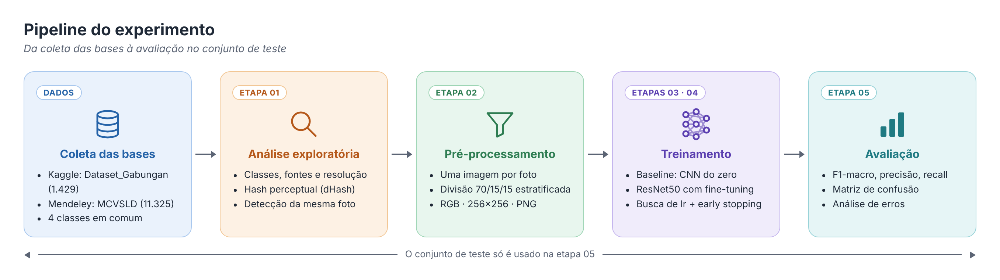
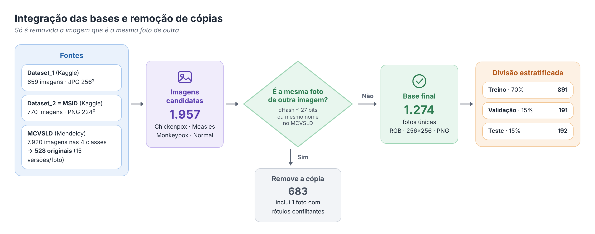
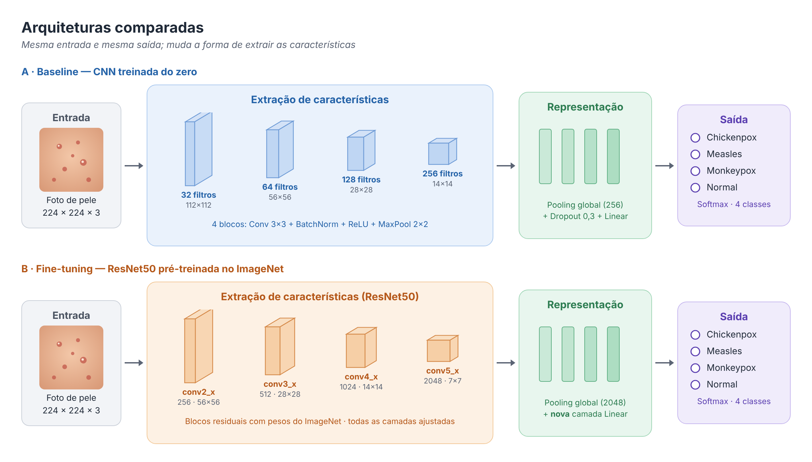
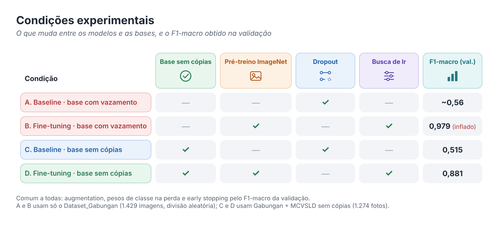

# Classificação de Doenças Infecciosas de Pele

Trabalho da disciplina de Visão Computacional (PUCPR). O objetivo é classificar fotos de pele em **4 classes** — Chickenpox (catapora), Measles (sarampo), Monkeypox (mpox) e Normal — comparando uma CNN treinada do zero com o fine-tuning de uma ResNet50 pré-treinada.

O ponto central do trabalho acabou sendo **a qualidade dos dados**: as bases públicas usadas têm a mesma foto repetida várias vezes, o que infla os resultados quando isso não é tratado.



---

## 1. Problema

Catapora, sarampo e mpox são doenças virais que causam lesões de pele parecidas. Um classificador baseado em fotos comuns (não dermatoscópicas) pode apoiar a triagem de forma rápida e barata.

Há duas dificuldades:
- **Classes parecidas:** as diferenças entre as lesões são sutis.
- **Poucos dados:** as bases públicas têm algumas centenas de fotos por classe.

## 2. Ponto de partida: o que a literatura faz

| Artigo | Base | Modelo | Resultado |
|---|---|---|---|
| Pai et al. (2023) | ~500 fotos, 5 classes (bactérias/fungos) | VGG16 com fine-tuning | 86% acurácia |
| Vajpayee et al. (2023) | MSID, 782 fotos, mesmas 4 classes | 10 CNNs; melhor EfficientNetV2L | 92,5% acurácia |
| Ahmed et al. (2026) | 1159 fotos, 8 classes | Híbrido MaxViT + MobileNet | 99,6% acurácia |

O que tiramos daqui:
- **Transfer learning é o caminho** para bases pequenas — justifica comparar CNN do zero vs. ResNet50 pré-treinada.
- **Hiperparâmetros de referência:** entrada 224×224, normalização do ImageNet, lr entre 1e-3 e 1e-5, augmentation e pesos de classe.
- **Lacuna:** nenhum dos artigos verifica fotos duplicadas, e dois deles não têm um conjunto de teste independente.

## 3. Dados

### 3.1 Fontes

| Base | Origem | O que contém |
|---|---|---|
| `Dataset_Gabungan` | Kaggle (`gupiii/infectious-skin-disease-dataset`) | Junção de `Dataset_1` (Univ. of Jammu, 659 imagens) e `Dataset_2` (MSID, 770 imagens) |
| MCVSLD | Mendeley Data (DOI 10.17632/dfztdtfsxz.1) | 11.325 imagens em 6 classes; usamos as 4 em comum (`Healthy` → `Normal`) |

### 3.2 O problema encontrado: a mesma foto várias vezes

A análise exploratória mostrou que as duas bases repetem fotos:

- No `Dataset_Gabungan`, o `Dataset_1` é praticamente o MSID redimensionado e salvo em outro formato.
- No MCVSLD, cada foto aparece em 15 versões aumentadas, e **100% das imagens de teste** têm uma versão da mesma foto no treino.

**Por que isso importa:** se a mesma foto cai no treino e no teste, o modelo é avaliado em algo que já viu. Na primeira rodada, sem tratamento, **58% do teste tinha cópia no treino** e a acurácia chegou a 98% — um número inflado.

### 3.3 Como identificamos a mesma foto

Comparar os bytes do arquivo (MD5) não basta: a mesma foto em outro tamanho ou formato gera um arquivo diferente. Usamos então dois critérios:

1. **Hash perceptual (dHash)** — para o `Dataset_Gabungan`.
   - A imagem é reduzida para 17×16 em tons de cinza.
   - Cada pixel é comparado com o vizinho da direita (mais claro ou mais escuro), gerando 256 bits.
   - Duas imagens são a mesma foto quando diferem em poucos bits. Isso resiste a mudança de tamanho, formato e compressão.
   - **Limiar de 27 bits, calibrado visualmente:** até 27 bits todos os pares conferidos eram a mesma foto; a partir de 31, fotos diferentes (figuras em `results/calibracao_limiar/`).

2. **Nome do arquivo** — para o MCVSLD.
   - Rotação e espelhamento mudam o hash, então as 15 versões são identificadas pelo nome (`MSL_01_01_1.jpg`, `MSL_01_01_ORIGINAL.jpg`…). Fica apenas a versão `_ORIGINAL`.

**Regra adotada: só é removida uma imagem quando ela é a mesma foto de outra.**



### 3.4 Base final

| Classe | Fotos únicas | Treino | Validação | Teste |
|---|---|---|---|---|
| Chickenpox | 175 | 122 | 27 | 26 |
| Measles | 141 | 99 | 21 | 21 |
| Monkeypox | 554 | 387 | 83 | 84 |
| Normal | 404 | 283 | 60 | 61 |
| **Total** | **1274** | **891** | **191** | **192** |

De 1957 imagens candidatas (1429 do Kaggle + 528 originais do MCVSLD nas 4 classes), restaram 1274 fotos únicas. As fotos do MCVSLD são todas novas em relação ao Kaggle.

## 4. Etapas do experimento

### Etapa 1 — Análise exploratória (`src/01_explorar_dados.py`)

**Objetivo:** conhecer a base antes de treinar.

- Lê as duas bases e alinha as classes.
- Mostra imagens por classe e por fonte, formato e resolução de cada fonte e cor média por classe e fonte.
- Calcula MD5 e dHash e agrupa as imagens que são a mesma foto.
- Gera `data/processed/imagens.csv` e as figuras em `results/`: distribuição de classes, exemplos, histograma de distâncias e pares agrupados.

### Etapa 2 — Pré-processamento (`src/02_dividir_dados.py`)

**Objetivo:** montar treino, validação e teste sem vazamento.

O fluxo completo está na figura da seção 3.3.

- **Rótulos conflitantes:** a mesma foto com duas classes é ambígua e sai da base (1 caso).
- **Uma imagem por foto:** garante que a mesma foto nunca esteja em dois conjuntos.
- **Divisão estratificada:** mantém a proporção das classes em cada conjunto (seed 42).
- **Padronização:** todas as imagens ficam iguais em formato e tamanho, para que a fonte não seja reconhecível pelo arquivo.

### Etapa 3 — Baseline (`src/03_treinar_baseline.py`)

**Objetivo:** medir até onde chega uma CNN treinada do zero.

- 4 blocos `Conv → BatchNorm → ReLU → MaxPool` (32 → 256 filtros), pooling global, dropout de 0,3 e camada linear.
- Adam com lr 1e-3, até 30 épocas.

### Etapa 4 — Fine-tuning (`src/04_treinar_finetuning.py`)

**Objetivo:** reaproveitar o que uma rede pré-treinada já sabe sobre imagens.

- ResNet50 com pesos do ImageNet; a última camada é trocada para 4 classes e **todas as camadas são ajustadas**.
- **Busca de lr em {1e-3, 1e-4, 1e-5}** — exatamente a faixa usada nos artigos de referência. Vence o maior F1-macro na validação.



**Configuração comum às etapas 3 e 4:**

| Item | Escolha | Motivo |
|---|---|---|
| Entrada | 224×224, normalização do ImageNet | Padrão para modelos pré-treinados |
| Augmentation (só treino) | Crop aleatório, flip horizontal, rotação ±15°, variação de cor | Base pequena; reduz overfitting |
| Perda | Entropia cruzada com pesos de classe | Classes desbalanceadas (Monkeypox ≈ 4× Measles) |
| Seleção do modelo | Melhor F1-macro na validação + early stopping (paciência 5) | F1-macro trata todas as classes igualmente |

O conjunto de teste **não participa** de nenhuma escolha.

### Etapa 5 — Avaliação (`src/05_avaliar.py`)

**Objetivo:** medir o desempenho final no conjunto de teste e entender os erros.

- Acurácia, precisão, recall e F1 por classe.
- Matriz de confusão, curvas de aprendizado e exemplos de acertos e erros.

## 5. Resultados



Leitura:
- **O vazamento inflava o resultado:** o fine-tuning caiu de 0,98 para 0,88 quando as cópias foram removidas.
- **Transfer learning faz diferença:** a CNN do zero não passa de ~0,5 com essa quantidade de dados.
- **Há overfitting no fine-tuning:** a perda de treino chega a ~0,03, contra ~0,35 na validação.

As métricas do conjunto de teste são geradas pela etapa 5 em `data/processed/metricas_teste.csv` e `results/`.

## 6. Limitações

- **Estilo diferente por fonte:** a classe Normal reúne retratos de estúdio (MSID) e close-ups de pele (MCVSLD); o modelo pode aprender o estilo da foto em vez da pele.
- **Divisão por foto, não por paciente:** o MCVSLD tem várias fotos do mesmo paciente.
- **Detecção de cópias:** o hash pega a mesma foto redimensionada ou recomprimida, mas pode não pegar a mesma foto recortada de outro jeito.
- **Teste pequeno:** Measles tem 21 imagens de teste; cada erro muda o recall em quase 5 pontos.

## 7. Como executar

1. Instale as dependências. Para usar GPU, instale antes o PyTorch com CUDA pelo comando indicado em pytorch.org.

   ```
   pip install -r requirements.txt
   ```

2. Configure o acesso ao Kaggle. O `kagglehub` baixa o `Dataset_Gabungan` automaticamente.
3. Baixe o MCVSLD no Mendeley Data e extraia em `data/raw/`, de forma que exista `data/raw/Skin Lesion Dataset/train`, `val` e `test`.
4. Rode os scripts a partir da raiz do repositório, nesta ordem:

   ```
   python src/01_explorar_dados.py
   python src/02_dividir_dados.py
   python src/03_treinar_baseline.py
   python src/04_treinar_finetuning.py
   python src/05_avaliar.py
   ```

### Estrutura

```
.
├── data/
│   ├── raw/            # MCVSLD extraído
│   ├── processed/      # CSVs gerados (imagens, divisão, históricos, métricas)
│   └── split/          # train/val/test gerados pela etapa 2
├── docs/               # artigos de referência
│   └── figuras/        # figuras do README (fonte editável: figuras.html)
├── models/             # baseline.pt e finetuning.pt
├── results/            # figuras geradas
├── src/                # scripts das etapas 1 a 5
└── requirements.txt
```

## Referências

- Pai, V. R. et al. (2023). *Identification and Classification of Skin Diseases using Deep Learning Techniques*. Research Square. DOI: 10.21203/rs.3.rs-2628782/v1
- Vajpayee, H. et al. (2023). *An effective classification of Skin Disease using Deep Learning Techniques*. Confluence 2023, IEEE. DOI: 10.1109/Confluence56041.2023.10048840
- Ahmed, S., Sakib, K. M. S., & Hany, U. (2026). *Hybrid deep learning architecture for skin disease classification*. Franklin Open, 15, 100556. DOI: 10.1016/j.fraope.2026.100556
- Bala, D., & Hossain, M. S. (2023). *Monkeypox Skin Images Dataset (MSID)*. Mendeley Data. DOI: 10.17632/r9bfpnvyxr.6
- Ahmed, K. R. et al. (2024). *Multi-Class Viral Skin Lesion Dataset (MCVSLD)*. Mendeley Data. DOI: 10.17632/dfztdtfsxz.1
- Prayoga, L. F. (2026). *Infectious Skin Disease Dataset & Classification using Hybrid MobileNetV2-Xception with CLAHE Image Enhancement*. Universitas Airlangga.
