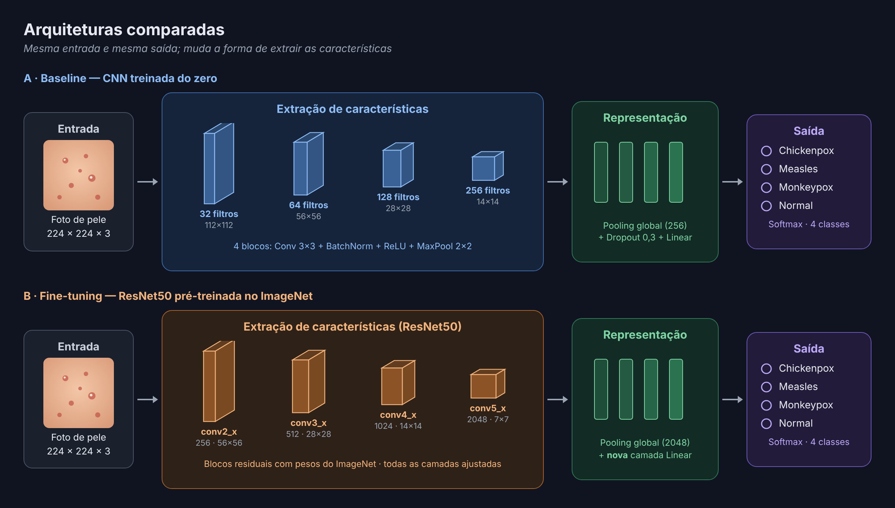

# Classificação de Doenças Infecciosas de Pele

Trabalho de Visão Computacional (PUCPR). Classificação de fotos de pele em **4 classes** — Chickenpox, Measles, Monkeypox e Normal — comparando uma CNN treinada do zero com o fine-tuning de uma ResNet50 pré-treinada.

| Modelo | Acurácia (teste) | F1-macro (teste) |
|---|---|---|
| CNN do zero | 45,8% | 0,430 |
| **ResNet50 (fine-tuning)** | **85,9%** | **0,836** |

O principal achado está nos dados: as bases públicas repetem a mesma foto várias vezes. Sem tratar isso, o mesmo modelo chegava a 98,1% — um resultado inflado.

## 1. Contexto

As três doenças são virais e causam lesões parecidas, e as bases públicas são pequenas. Na literatura, transfer learning domina e os resultados vão de 86% a 99,6% de acurácia (Pai et al., 2023; Vajpayee et al., 2023; Ahmed et al., 2026). Nenhum desses trabalhos verifica fotos duplicadas.

## 2. Dados

| Base | Origem | Uso |
|---|---|---|
| `Dataset_Gabungan` | Kaggle (`gupiii/infectious-skin-disease-dataset`) | `Dataset_1` (659 imagens) + `Dataset_2` = MSID (770 imagens) |
| MCVSLD | Mendeley Data (DOI 10.17632/dfztdtfsxz.1) | 4 classes em comum (`Healthy` → `Normal`) |

**Problema encontrado:**
- 95% das imagens do `Dataset_1` são fotos do MSID redimensionadas e em outro formato.
- O MCVSLD traz cada foto em 15 versões aumentadas, espalhadas entre treino, validação e teste.
- Resultado: na primeira divisão, 58% das imagens de teste tinham uma cópia no treino.

**Como as cópias foram identificadas:**
- **Hash perceptual (dHash):** reduz a imagem a 17×16 em cinza e compara cada pixel com o vizinho, gerando 256 bits que não mudam com tamanho ou formato. Duas imagens com até 27 bits de diferença são a mesma foto — limiar calibrado visualmente (`results/calibracao_limiar/`).
- **Nome do arquivo no MCVSLD:** rotações e espelhamentos mudam o hash, então só a versão `_ORIGINAL` de cada foto é usada.

Só é removida uma imagem quando ela é a mesma foto de outra.

| Passo | Imagens |
|---|---|
| Kaggle + MCVSLD (só originais, 4 classes) | 1.429 + 528 = 1.957 |
| Cópias removidas | − 683 |
| **Base final** | **1.274** |

| Classe | Treino | Validação | Teste | Total |
|---|---|---|---|---|
| Chickenpox | 122 | 27 | 26 | 175 |
| Measles | 99 | 21 | 21 | 141 |
| Monkeypox | 387 | 83 | 84 | 554 |
| Normal | 283 | 60 | 61 | 404 |

## 3. Método

| Etapa | Script | O que faz |
|---|---|---|
| 1 | `src/01_explorar_dados.py` | Junta as bases, descreve classes e fontes, encontra as cópias |
| 2 | `src/02_dividir_dados.py` | Mantém uma imagem por foto, divide 70/15/15 estratificado e padroniza para RGB 256×256 PNG |
| 3 | `src/03_treinar_baseline.py` | Treina a CNN do zero |
| 4 | `src/04_treinar_finetuning.py` | Ajusta a ResNet50, com busca de lr em {1e-3, 1e-4, 1e-5} |
| 5 | `src/05_avaliar.py` | Avalia no teste: métricas, matriz de confusão, curvas e exemplos |



**Treino (igual para as duas redes):** entrada 224×224 com normalização do ImageNet; augmentation só no treino (crop, flip, rotação ±15°, cor); entropia cruzada com pesos de classe; modelo escolhido pelo melhor F1-macro na validação, com early stopping (paciência 5). O teste não participa de nenhuma escolha.

## 4. Resultados

### Efeito das cópias

| Condição | F1-macro (val.) | Acurácia (teste) | F1-macro (teste) |
|---|---|---|---|
| CNN do zero · com cópias | 0,56 | 61,5% | 0,534 |
| ResNet50 · com cópias | 0,979 | 98,1% | 0,974 |
| CNN do zero · sem cópias | 0,515 | 45,8% | 0,430 |
| **ResNet50 · sem cópias** | **0,881** | **85,9%** | **0,836** |

"Com cópias" usa só o `Dataset_Gabungan` (1.429 imagens, divisão aleatória).

### Convergência

- **CNN do zero — underfitting:** perdas de treino e validação ficam em ~1,15; a rede não aprende a separar as classes.
- **ResNet50 — overfitting:** perda de 0,03 no treino contra 0,39 na validação; o early stopping guarda a melhor época (14 de 19).
- **Busca de lr:** 1e-4 venceu (F1 0,881), contra 0,804 com 1e-3 e 0,798 com 1e-5.

### Por classe (ResNet50, teste)

| Classe | Precisão | Recall | F1 |
|---|---|---|---|
| Chickenpox | 0,63 | 0,73 | 0,68 |
| Measles | 0,86 | 0,86 | 0,86 |
| Monkeypox | 0,86 | 0,86 | 0,86 |
| Normal | 0,98 | 0,92 | 0,95 |

| Real \ Previsto | Chickenpox | Measles | Monkeypox | Normal |
|---|---|---|---|---|
| Chickenpox | **19** | 1 | 6 | 0 |
| Measles | 0 | **18** | 3 | 0 |
| Monkeypox | 11 | 0 | **72** | 1 |
| Normal | 0 | 2 | 3 | **56** |

- **Monkeypox × Chickenpox concentra 17 dos 27 erros:** as duas doenças formam vesículas e pústulas parecidas.
- **Normal é a classe mais fácil**, mas pode estar se apoiando no estilo da foto (ver limitações).

## 5. Limitações

- **Estilo por fonte:** a classe Normal mistura retratos de estúdio (MSID) e close-ups de pele (MCVSLD); o modelo pode aprender o estilo da foto.
- **Divisão por foto, não por paciente:** o MCVSLD tem várias fotos do mesmo paciente.
- **Detecção de cópias:** o hash não garante pegar a mesma foto recortada de outro jeito.
- **Teste pequeno:** 21 imagens de Measles; cada erro muda o recall em ~5 pontos.

Próximos passos: Grad-CAM para ver onde o modelo olha, divisão por paciente e validação cruzada.

## 6. Como executar

1. `pip install -r requirements.txt` (para GPU, instale antes o PyTorch com CUDA pelo site pytorch.org).
2. Configure o acesso ao Kaggle; o `kagglehub` baixa o `Dataset_Gabungan`.
3. Baixe o MCVSLD no Mendeley Data e extraia em `data/raw/` (deve existir `data/raw/Skin Lesion Dataset/train`).
4. Na raiz do repositório:

   ```
   python src/01_explorar_dados.py
   python src/02_dividir_dados.py
   python src/03_treinar_baseline.py
   python src/04_treinar_finetuning.py
   python src/05_avaliar.py
   ```

Saídas: `data/processed/` (CSVs), `data/split/` (imagens divididas), `models/` (pesos) e `results/` (figuras).

## Referências

- Pai, V. R. et al. (2023). *Identification and Classification of Skin Diseases using Deep Learning Techniques*. Research Square. DOI: 10.21203/rs.3.rs-2628782/v1
- Vajpayee, H. et al. (2023). *An effective classification of Skin Disease using Deep Learning Techniques*. Confluence 2023, IEEE. DOI: 10.1109/Confluence56041.2023.10048840
- Ahmed, S., Sakib, K. M. S., & Hany, U. (2026). *Hybrid deep learning architecture for skin disease classification*. Franklin Open, 15, 100556. DOI: 10.1016/j.fraope.2026.100556
- Bala, D., & Hossain, M. S. (2023). *Monkeypox Skin Images Dataset (MSID)*. Mendeley Data. DOI: 10.17632/r9bfpnvyxr.6
- Ahmed, K. R. et al. (2024). *Multi-Class Viral Skin Lesion Dataset (MCVSLD)*. Mendeley Data. DOI: 10.17632/dfztdtfsxz.1
